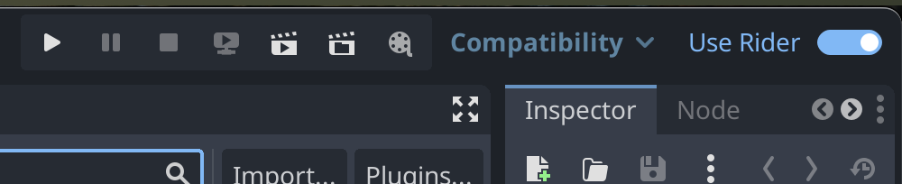

# JetBrains Rider Integration – Godot addon

Godot 4.6+ editor plugin. Simplifies setting up Rider as External Editor. Helps to initialize the Godot ↔ Rider bridge (`godot-rd`) with the selected Rider install. Features such as **Open in Rider** / **Open in Godot** come from the bridge after it loads.

## What this addon does

1. **Rider discovery** — Native GDExtension (`RiderLocator`) finds Rider installs on Windows, macOS, and Linux.
2. **External editor selector** — Adds a **Select Rider** dropdown under **Editor → Editor Settings… → Text Editor → External** (`text_editor/external/editor`). A choice sets `text_editor/external/exec_path` and triggers bridge load for that install.
3. **Godot ↔ Rider bridge** — When `text_editor/external/exec_path` points at a Rider binary, loads `godot-rd.gdextension` from that install. Changing Rider after a different RD build was loaded may ask you to restart Godot.
4. **Use Rider toolbar toggle** — Applies or reverts editor settings from `presets.json` (external editor, save/reload on focus, game embed mode, and related options). State is stored in `plugin.cfg` as `presets/active` (`on` / `off`).

## Quick start

Requirements:
- Godot 4.6+.
- JetBrains Rider 2026.3 (for the Godot ↔ Rider bridge)

Install:
1. In Godot, install from AssetStore or download from [github releases](https://github.com/JetBrains/godot-support/releases).
2. [Optional] Change the initial value of `active` in the plugin.cfg
3. [Optional] Change the initial values in the presets.json file.
4. Enable "JetBrains Rider External Editor" plugin in the Project → Project Settings… → Plugins tab.

Use:
1. Open **Editor Settings → Text Editor → External**. Wait for discovery if the control shows a searching state, then pick a Rider build so the bridge can load.
2. Use the toolbar **Use Rider** toggle to turn the recommended preset on or off.

Screenshot:

## What the toggle changes

The preset values live in `presets.json`.

When ON:
- Write the values from the "on" preset into the Editor Settings.

When OFF:
- Write the values from the "off" preset into the Editor Settings.

## License

See `LICENCE` in this folder.

## Acknowledgements

Created by JetBrains to streamline using Rider with Godot.  
Initial idea: https://github.com/sszigeti/toggle_external_editor
